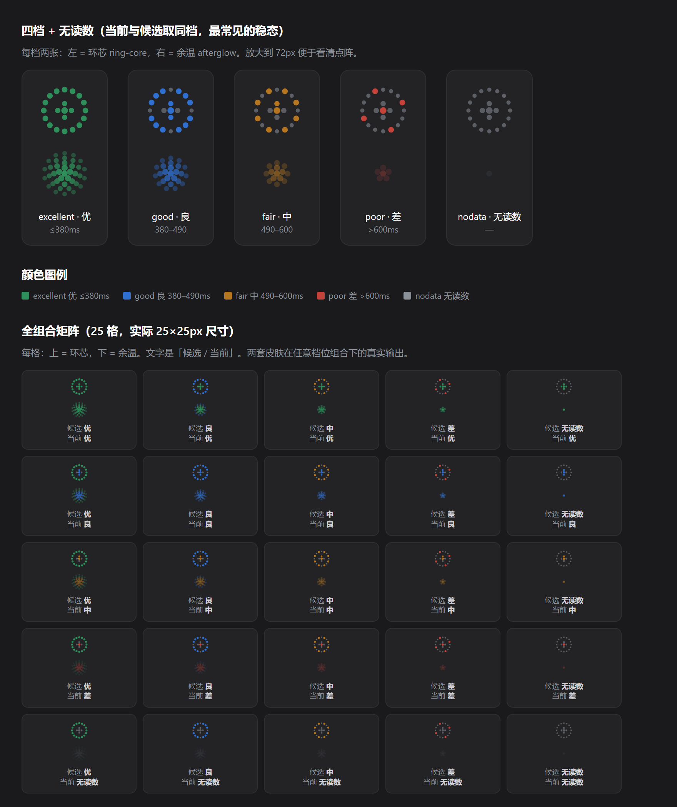

# 图标状态与自动切换规则

> 面向使用者。看完这一页你应该能回答三个问题：**图标现在表示什么**、
> **它为什么没切**、**切了之后我该做什么**。
>
> 图里的每个像素都由 `client.js` 的皮肤函数实际渲染产出（不是示意图），
> 点亮的点数是从渲染结果里数出来的。技术规格见 [UI-SPEC.md](../UI-SPEC.md)。



---

## 1. 图标在哪、多大

聊天输入框**左侧**一枚 25×25px 的图形，**没有一个字**。它同时表达两件事：

- **当前线路**多快（你现在正在用的这条）
- **候选线路**多快（插件测到的、值得换过去的最好那条）

两套皮肤，配置页可切：

| 皮肤 | 读法 |
|---|---|
| **环芯** `ring-core`（默认） | **外圈**的亮点数 = 候选；**内芯**的亮点数 = 当前 |
| **余温** `afterglow` | **光铺到第几圈** = 候选；**中心多亮** = 当前 |

---

## 2. 五档：颜色与形状都不会骗你

档位只看一个量：**TTFB 的 p50**（取首字节耗时，不是端到端，也不是 TCP）。

| 档位 | 阈值 | 颜色 | 环芯外圈/内芯 | 余温可见点 |
|---|---|---|---|---|
| `excellent` 优 | ≤ 380ms | 绿 | 16/16 + 5/5 | 39 |
| `good` 良 | 380–490ms | 蓝 | 12/16 + 3/5 | 25 |
| `fair` 中 | 490–600ms | 橙 | 8/16 + 2/5 | 14 |
| `poor` 差 | > 600ms | 红 | 4/16 + 1/5 | 6 |
| `nodata` 无读数 | — | 灰 | 0/16 + 0/5 | 1 |

**「亮的点越少 = 越慢」是唯一的读法**，两套皮肤都成立。点数单调递减，
不会出现「档位更差反而更亮」。

几个容易误读的地方：

- **`nodata` 不是「优」**。环芯会变成一圈灰暗点（外圈全暗），余温只剩中心一颗暗芯。
  `nodata` 表示「还没测到」，不是「测得很快」。所以 `data-tier` 遇到 `nodata`
  一律降级成 `poor`——什么都测不到不该被画成优。
- **颜色是第二通道**。远看/色盲时靠点数与圈数读档位，颜色只是加速识别。
- **两侧取更差**。`<svg data-tier>` 挂的是当前与候选里更差的那一档，
  但每侧的色相是各自算的——所以你会看到「绿外圈 + 蓝内芯」这种组合，
  意思是「候选是优、当前是良」。

---

## 3. 不转的时候，图标在说什么

静止状态全部是「压暗」或「慢呼吸」，**没有一个是装饰**：

| 你看到的 | 含义 | 该做什么 |
|---|---|---|
| 整图变淡（约 55%） | 这一轮没测到数据，稍后自动重试 | 不用管 |
| 整图更淡（约 45%） | 网络连不上，暂停检测 | 检查网络 |
| 候选侧变淡 | 候选读数已过期 / 还在沿用当前值 | 不用管，下一轮会刷新 |
| 慢呼吸（2.8s 一轮） | **找到了更快的线路，但需要管理员权限** | 用管理员身份重启宿主 |
| 慢呼吸（2.8s，且自动切换是关的） | 有更快的线，但你关了自动切换 | 想让它切就打开自动切换 |
| 候选侧脉动（1.7s） | 候选确实更快（够不够阈值都算） | 不用管，它会自己切 |
| 明暗闪（2.4s） | **全劣化**：所有候选都在丢包 | 看情况，可以点图标手动切 |

**注意「慢呼吸」只在「候选确实更快」时才出现**。只有权限不足、但没有更快的线时，
图标不会呼吸——那样会骚扰你。

---

## 4. 会动的时刻（都是真事件）

| 动作 | 时长 | 什么时候发生 |
|---|---|---|
| 落位 | 480ms | 宿主刚启动、**全局**第一次拿到读数（切会话不重播） |
| 测速起 | 循环到结束 | 你点了图标或「立即检测」 |
| 测速收 | 1400ms | 扫描完成，读头刹车停住 |
| 换线 | 1500ms | 刚刚真的改写了 hosts |
| 悬停提示 | — | 鼠标悬停 / 键盘聚焦，显示具体毫秒数 |

**优先级**：测速 > 换线 > 候选更快 > 其余。测速期间其他循环动画一律让位。

悬停时补上纯视觉表达不了的数字：

```
当前  312ms
候选  128ms
候选读数已过期        ← 只有该条件成立时才出现第三行
```

断网时当前行显示「断网，测不到」，候选还在借用当前值时显示「沿用当前（尚未测速）」，
都没数据时显示「暂无数据」——**不编数字**。

---

## 5. 自动切换规则

### 5.1 什么时候会切

每隔一段时间（由并发数推导，默认约 2–3 分钟）跑一轮候选实测：从 256 个 CF 边缘 IP
里粗筛存活者 → 读机房过滤远端 → 轮换取 12 个 → 每个跑 20s 窗口测 p50/loss →
分档排序。然后按下面的规则判定：

**切，当且仅当两个条件同时成立：**

1. **候选最优 p50 比当前低 ≥ 150ms**（阈值可调）
2. 当前读数**可信**（样本数 ≥ 3，或丢包已过半——那是明确坏证据，样本少也认）

再加三条**执行前**的前置条件：

3. 有管理员权限（写 hosts 需要）
4. 自动切换是开着的
5. 没有思考流正在飞（有的话记为「等待写入」，这条回复结束立刻切）

### 5.2 什么情况下**不**切

| 状态 | 含义 |
|---|---|
`cold-start` | 还没测到当前读数 |
`observing` | 有更快的线，但差距不够 150ms |
`auto-off` | 差距够了，但你关了自动切换 |
`waiting-write` | 差距够了，等这条回复结束就切 |
`no-candidate` | 没有更好的线路（或候选证书全不适配） |
`all-degraded` | 当前偏慢，候选也全在丢包，且没有明显更好 |
`offline` | 网络连不上 |
`probe-failed` | 这一轮没测到数据 |
`need-admin` | 找到了更快的线，只差权限 |

### 5.3 全劣化时仍然会切

**所有候选都在丢包时，插件不会摆烂不切。** 它会退到「相对择优」：取丢包少 → p50 小的
第一条，但多一条约束——**丢包率不能比当前更高**（不拿延迟换丢包）。

这时状态是 `degraded-switched`（不是 `switched`），说的是「全部线路偏慢，已切到相对较好的一条」，
而不是「找到了更快的线路」——**两种事实不能混**。

如果写入的候选丢包率确实比原线路更高，文案会再降一级：「已切到延迟较低的一条（丢包更多）」。

### 5.4 没有的规则（重要）

这些**故意不做**，都是用户明确否决过的：

- **没有次数上限**。不存在「今天已经切了 N 次，不再切」。网络质量本身在变，
  用固定次数拦住「该切」，只会让你被烂死在一条线路上——那正是这个插件要解决的问题。
- **没有冷却期**、没有「连续 N 轮才切」、没有地板值。
- **不会切回去**。写入后不做观察、不自动回退。反悔成本只有「机器被多换几次」。
- **不会因为 p95 高就判「断」**。p95 只做同档内的并列裁决。「慢」和「断」是两件事：
  断只看丢包/超时。
- **不会把网络超时当成证书失败**。那会让烂网络把自己锁死。

---

## 6. 写 hosts 前的安全边界：证书闸门

改动系统 hosts 是这台机器上唯一的真实副作用，所以写入前有一道**证书闸门**：
对每个要写的候选，用**真实主机名**做一次证书链 + 主机名校验。结论分四类，处置不同：

| 结论 | 处置 |
|---|---|
| **通过** | 放行 |
| **真证书不匹配**（`证书校验失败` 前缀） | 剔除该候选，并记住这个 IP 1 小时 |
| **临时链路问题**（超时 / ECONNRESET 等） | 它什么都没证明 → 重试一次；仍失败则放行但标记「未校验」 |
| **认不出来的错误** | 没有安全证据 → 按不通过处理 |

闸门是**逐候选过滤**，不是全有或全无：首选证书失败不会连累已通过校验的备选。
只有全部候选都不通过才如实失败。

**候选全部被判死时不会回退到全量重试**——那会让每一拍都重新握手一遍、注定失败、
3 秒后再来。记忆等于没记。这时状态如实给 `no-candidate`，原因写在「最近错误」里。

---

## 7. 手动操作

**所有由你点击触发的操作都不会被拦截。**

| 动作 | 怎么做 | 行为 |
|---|---|---|
| 测速并切换 | **点图标本身** | 扫描 → 刹车 1400ms → 写入 hosts |
| 只测速 | 配置页「立即检测」 | 完整重扫，不复用上一轮 |
| 只写入 | 配置页「立即切换」 | 不受自动切换开关、差距不足影响 |
| 撤掉固定 | 配置页「取消固定」 | 删掉 hosts 标记段，回退系统 DNS |

两个会话同时点（或图标与配置页各点一次）时，第二个请求**合并**到正在跑的那一份，
不会并跑两份 256 次粗筛，也不会两次交错写 hosts 冲掉备份。

**结果文案与进度文案分开**：先点「立即检测」、没结束时又点「立即切换」，
切换结果（「已切到 X」）不会被随后返回的「测速完成」覆盖掉。

---

## 8. 配置页三段语气

配置页只在需要时打开，文字都在这里：

1. **只读诊断**：当前 IP / 当前延迟 / 更快候选 / 最近一轮 / 上次切换 / 权限 /
   hosts 路径 / 域名 / **最近错误**
2. **决定**：自动切换开关、阈值、探测间隔、并发、启用哪些域名
3. **高级**（折叠）：皮肤、派生读数（一轮多久、多少候选）

> ⚠️ **`candidates[].tier` 与 `certFailed` 不在配置页显示。**
> 它们只出现在 `/state` 快照里（给外部观察者与测试用）。
> 想知道某个候选具体被分成哪一档，看快照，不要在配置页找。

---

## 9. 一句话总结

**图标安静是默认状态**。它只在三种时刻打扰你：值得你动手（要权限）、
刚发生变化（换了线）、以及正在做你要它做的事（测速）。
其余时间它只是余光里的一个读数。

判定规则的核心就一句：**候选比当前快 150ms 以上就切，没有次数限制，
全劣化了也切（但不拿延迟换丢包）。**
